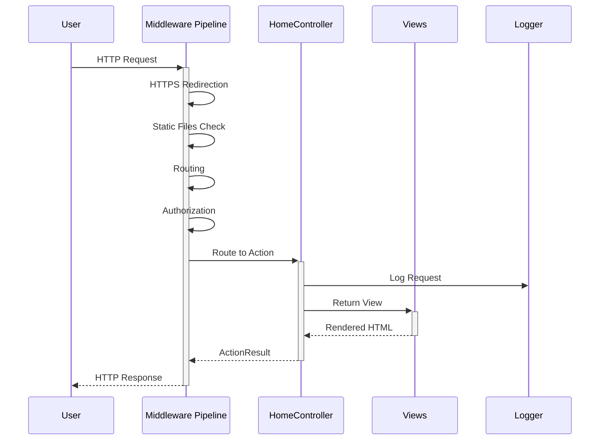

# Bulky Web Application - Architecture Diagram

## Project Overview
**Bulky** is an ASP.NET Core 8.0 MVC web application with a traditional Model-View-Controller architecture.

## Architecture Diagram

```mermaid
graph TB
    %% External Layer
    User[👤 User/Browser]
    
    %% Presentation Layer
    subgraph "Presentation Layer"
        Views[📄 Views]
        subgraph "Views Structure"
            HomeViews[🏠 Home Views<br/>- Index.cshtml<br/>- Privacy.cshtml]
            SharedViews[🔗 Shared Views<br/>- _Layout.cshtml<br/>- Error.cshtml<br/>- _ValidationScriptsPartial.cshtml]
            ViewConfig[⚙️ View Configuration<br/>- _ViewImports.cshtml<br/>- _ViewStart.cshtml]
        end
        
        StaticFiles[📁 Static Assets]
        subgraph "wwwroot"
            CSS[🎨 CSS Files]
            JS[⚡ JavaScript Files]
            Lib[📚 Libraries]
            Favicon[🌟 favicon.ico]
        end
    end
    
    %% Application Layer
    subgraph "Application Layer"
        Controllers[🎮 Controllers]
        subgraph "Controller Layer"
            HomeController[🏠 HomeController<br/>- Index()<br/>- Privacy()<br/>- Error()]
        end
        
        Program[🚀 Program.cs<br/>Application Entry Point]
        
        subgraph "Configuration"
            AppSettings[⚙️ appsettings.json]
            DevSettings[🔧 appsettings.Development.json]
        end
    end
    
    %% Business Logic Layer
    subgraph "Business Logic Layer"
        Models[📊 Models]
        subgraph "Model Layer"
            ErrorViewModel[❌ ErrorViewModel<br/>- RequestId<br/>- ShowRequestId]
        end
    end
    
    %% Infrastructure Layer
    subgraph "Infrastructure Layer"
        Logging[📝 ILogger&lt;HomeController&gt;]
        Middleware[🔄 ASP.NET Core Middleware Pipeline]
        subgraph "Middleware Components"
            ExceptionHandler[🛡️ Exception Handler]
            HSTS[🔒 HSTS]
            HTTPS[🔐 HTTPS Redirection]
            StaticFileMiddleware[📁 Static Files]
            Routing[🗺️ Routing]
            Authorization[🔑 Authorization]
        end
    end
    
    %% Project Structure
    subgraph "Project Structure"
        Solution[📋 Bulky.sln<br/>Visual Studio Solution]
        ProjectFile[📦 BulkyWeb.csproj<br/>.NET 8.0 Web SDK]
        GitConfig[📝 Git Configuration<br/>- .gitignore<br/>- .gitattributes]
    end
    
    %% Flow Connections
    User --> Views
    User --> StaticFiles
    
    Views --> Controllers
    Controllers --> Models
    Controllers --> Logging
    
    Program --> Controllers
    Program --> Middleware
    Program --> AppSettings
    Program --> DevSettings
    
    HomeController --> ErrorViewModel
    
    Solution --> ProjectFile
    ProjectFile --> Program
    
    %% Styling
    classDef userClass fill:#e1f5fe,stroke:#01579b,stroke-width:2px
    classDef presentationClass fill:#f3e5f5,stroke:#4a148c,stroke-width:2px
    classDef applicationClass fill:#e8f5e8,stroke:#1b5e20,stroke-width:2px
    classDef businessClass fill:#fff3e0,stroke:#e65100,stroke-width:2px
    classDef infrastructureClass fill:#fce4ec,stroke:#880e4f,stroke-width:2px
    classDef projectClass fill:#f1f8e9,stroke:#33691e,stroke-width:2px
    
    class User userClass
    class Views,HomeViews,SharedViews,ViewConfig,StaticFiles,CSS,JS,Lib,Favicon presentationClass
    class Controllers,HomeController,Program,AppSettings,DevSettings applicationClass
    class Models,ErrorViewModel businessClass
    class Logging,Middleware,ExceptionHandler,HSTS,HTTPS,StaticFileMiddleware,Routing,Authorization infrastructureClass
    class Solution,ProjectFile,GitConfig projectClass
```

## Application Flow



## Key Features

### 🏗️ **Architecture Pattern**
- **MVC (Model-View-Controller)** pattern
- **ASP.NET Core 8.0** framework
- **Dependency Injection** container

### 🎯 **Current Functionality**
- **Home Page** - Main landing page
- **Privacy Page** - Privacy policy page  
- **Error Handling** - Custom error pages with request tracking
- **Static File Serving** - CSS, JavaScript, and other assets
- **Responsive Layout** - Shared layout template

### 🔧 **Technical Stack**
- **.NET 8.0** - Latest LTS version
- **ASP.NET Core MVC** - Web framework
- **Razor Views** - Server-side rendering
- **Built-in Logging** - ILogger interface

### 📁 **Project Structure**
```
Bulky/
├── BulkyWeb/
│   ├── Controllers/
│   │   └── HomeController.cs
│   ├── Models/
│   │   └── ErrorViewModel.cs
│   ├── Views/
│   │   ├── Home/
│   │   │   ├── Index.cshtml
│   │   │   └── Privacy.cshtml
│   │   └── Shared/
│   │       ├── _Layout.cshtml
│   │       ├── Error.cshtml
│   │       └── _ValidationScriptsPartial.cshtml
│   ├── wwwroot/
│   │   ├── css/
│   │   ├── js/
│   │   └── lib/
│   ├── Program.cs
│   ├── BulkyWeb.csproj
│   └── appsettings.json
└── Bulky.sln
```

## 🚀 **Getting Started**
This appears to be a starter template for an ASP.NET Core MVC application, ready for expansion with additional features like:
- Database integration
- User authentication
- Business logic implementation
- API endpoints
- Additional controllers and views